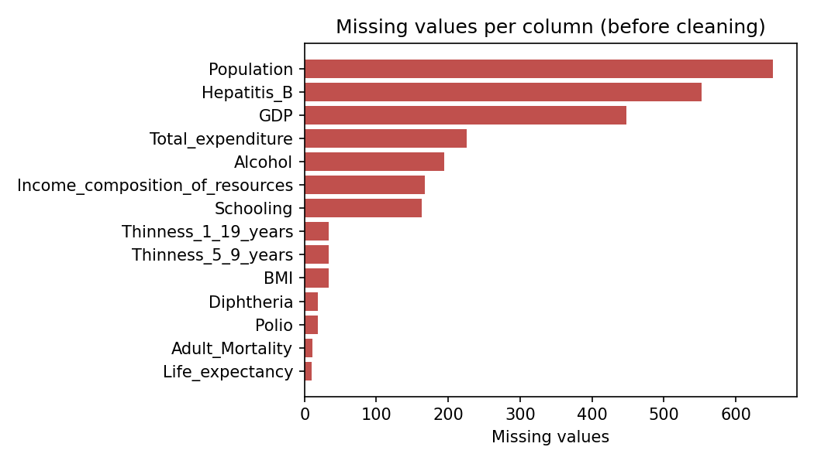
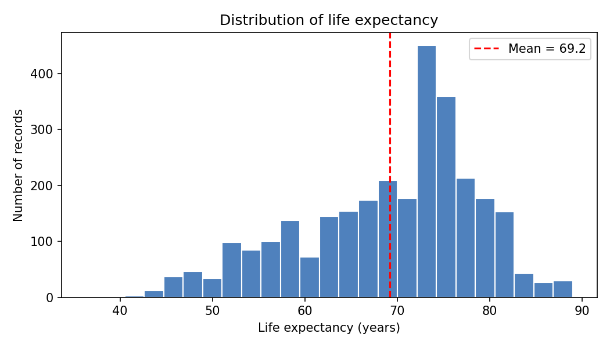
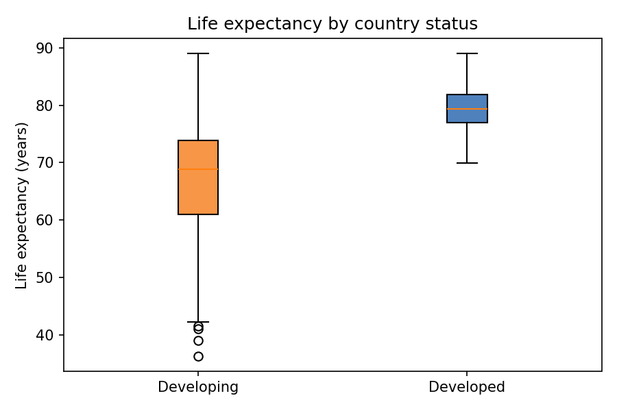
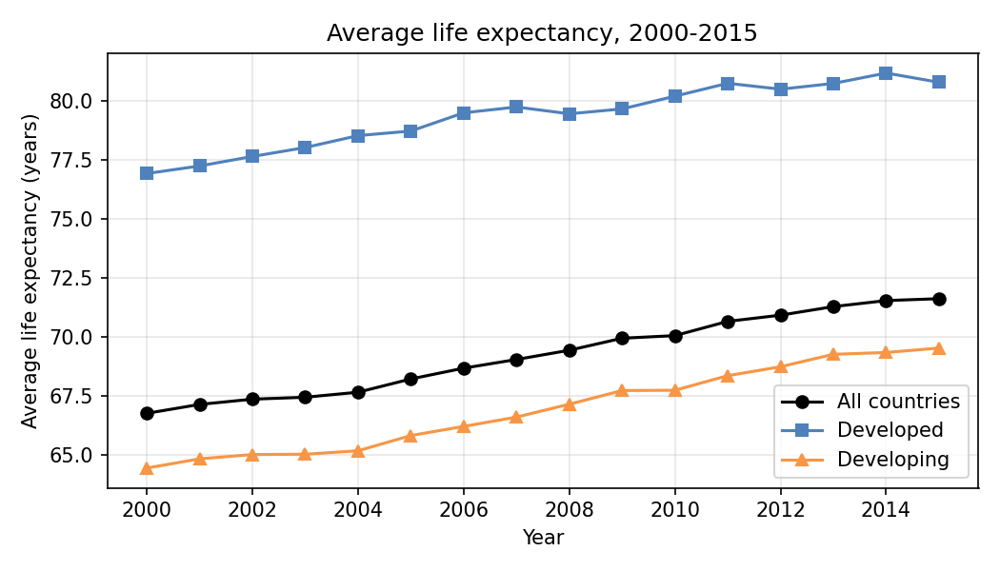
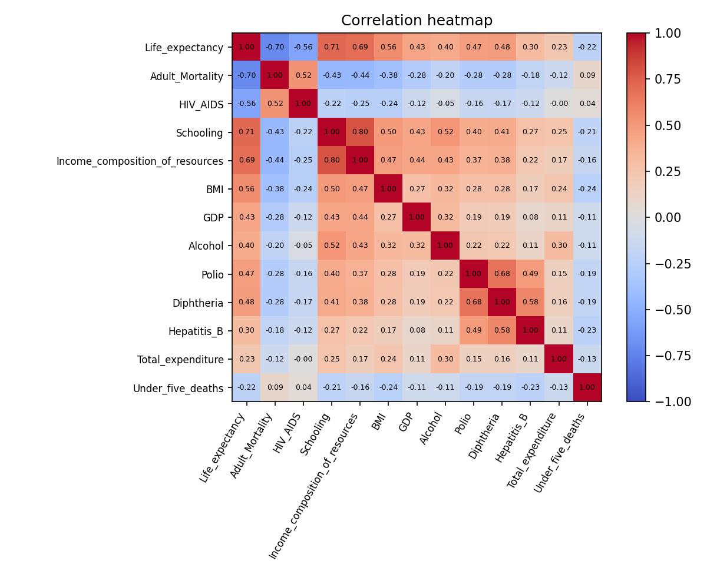
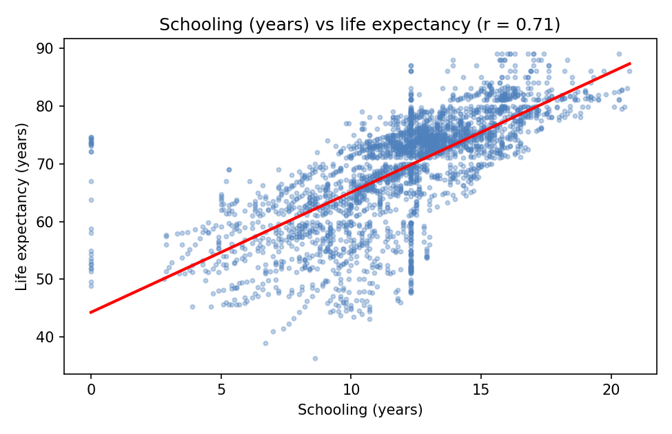
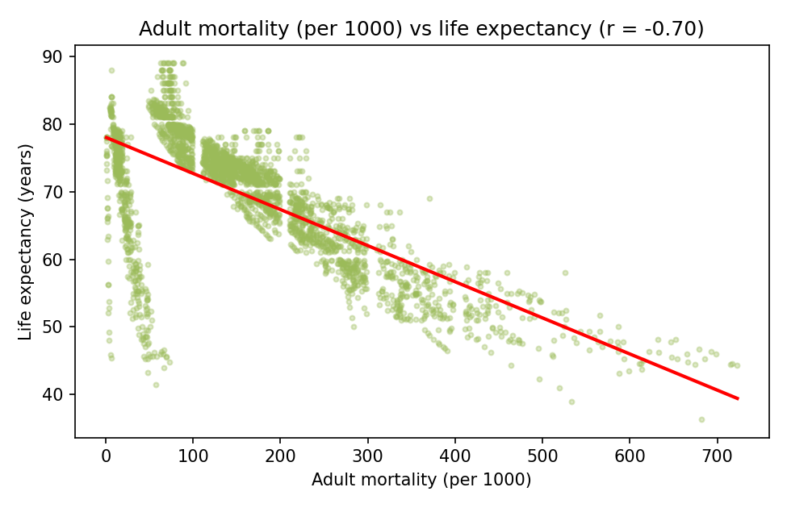
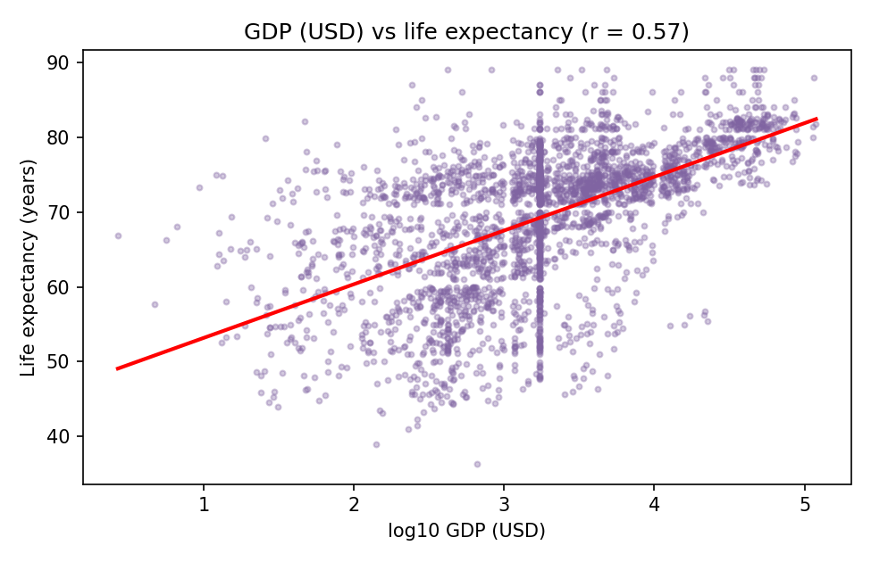
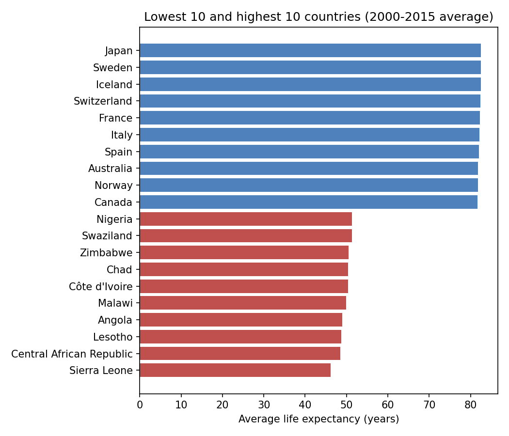
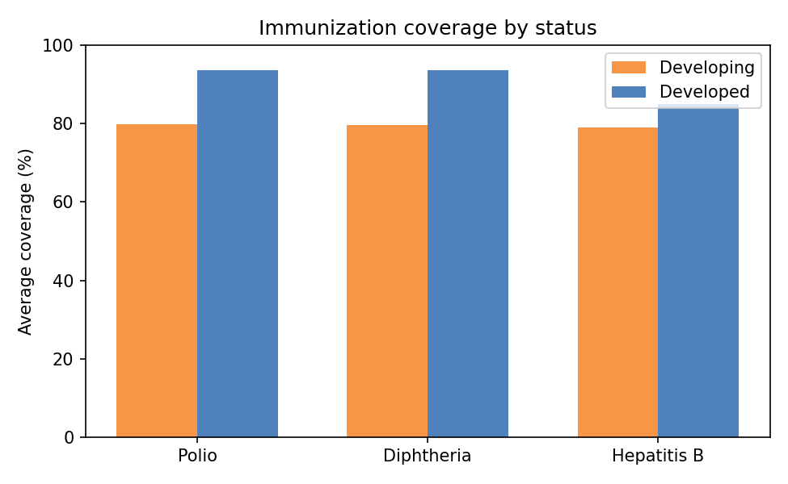

# life-expectancy-analysis
Statistical analysis of factors affecting life expectancy using WHO data (Python)
# Life Expectancy Analysis (WHO Data)

A Python data analysis project that studies which factors are linked to life expectancy across 193 countries (2000 to 2015), using Pandas, NumPy, SciPy and Matplotlib.

## Team

| Name | Enrollment No. |
|---|---|
| Janmejaynarayan Rawal | IU2441230577 |
| Harsh Sorathiya | IU2441230562 |

**Course:** Python Programming
**Guide:** Prof. Vatsal Shinghala

## Project Definition

We want to understand why life expectancy differs so much between countries. The project cleans the WHO dataset, compares developed and developing countries, checks the trend over the years, and measures how factors like schooling, adult mortality, income and immunization relate to life expectancy. A Tkinter dashboard will be added in the final stage.

## Dataset

**Life Expectancy (WHO)**, Kaggle: https://www.kaggle.com/datasets/kumarajarshi/life-expectancy-who

- 2,938 rows and 22 columns
- 193 countries (34 Developed, 159 Developing), years 2000 to 2015
- Covers mortality, immunization, economic and social indicators

Missing values were found in 14 columns (most in Population, Hepatitis B and GDP). They were filled with the median of the same country.

## Results and Graphs

**Main findings**

- Developed countries average **79.4 years** and developing countries **66.9 years** (Welch t-test, p < 0.001).
- Average life expectancy rose from **66.8 (2000)** to **71.6 (2015)**, and the gap between the two groups got smaller.
- Schooling (r = 0.71) and adult mortality (r = -0.70) are the factors most strongly linked to life expectancy.
- One extra year of schooling goes with about 2.1 more years of life expectancy (R² = 0.51).

### Missing values


### Distribution of life expectancy


Mean is 69.2 years and median 72.1, so the data is skewed to the left.

### Developed vs developing countries


### Trend from 2000 to 2015


Developing countries gained 5.1 years and developed countries 3.9 years, so the gap fell from 12.5 to 11.3 years.

### Correlation heatmap


### Schooling vs life expectancy


### Adult mortality vs life expectancy


### GDP vs life expectancy (log scale)


### Highest and lowest countries


Japan, Sweden and Iceland are highest. Sierra Leone, Central African Republic and Lesotho are lowest.

### Immunization coverage


Note: correlation does not prove cause, and filling missing values can slightly affect the numbers.

## Libraries and Tools

| Tool | Use |
|---|---|
| Pandas | Loading, cleaning, groupby and aggregation |
| NumPy | Arrays and statistics |
| SciPy | t-test and linear regression |
| Matplotlib | All graphs |
| Tkinter | Dashboard (planned) |
| re | Cleaning column names |

Python 3, VS Code, Git and GitHub.

## How to Run

1. Keep `Life Expectancy Data.csv` (included in this repository, or download it from the Kaggle link above) in the same folder as `analysis.py`.
2. Install the libraries and run:

```
pip install -r requirements.txt
python analysis.py
```

The graphs are saved in the `graphs` folder and the statistics are printed in the terminal.

## Repository Files

```
life-expectancy-analysis/
├── graphs/                                  # the 10 graph images (f1 to f10)
├── analysis.py                              # cleaning, statistics and graphs
├── Life Expectancy Data.csv                 # dataset
├── requirements.txt                         # libraries needed
├── All_Graphs.pdf                           # all graphs in one file
├── Project_Proposal_Life_Expectancy_v2.pdf  # project proposal (PDF)
├── Project_Proposal_Life_Expectancy_v2.docx # project proposal (Word)
└── README.md
```

## Project Status

First analysis and graphs are complete. Remaining work: organize the code into classes, build the Tkinter dashboard and write the final report.
